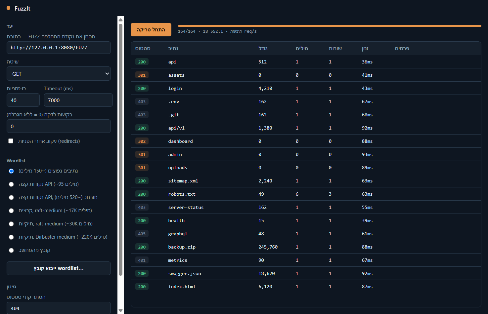

# FuzzIt

A lightweight Windows desktop fuzzer for web content discovery, inspired by
[ffuf](https://github.com/ffuf/ffuf). The fuzzing engine is written from
scratch in Rust. The UI is a React + TypeScript app running in a Tauri
window. There's no dependency on `ffuf.exe` or any other external binary.



> [!WARNING]
> **Authorized use only.** FuzzIt sends large numbers of HTTP requests to
> whatever target you give it. Only scan systems you own, or systems you have
> explicit written permission to test (for example, an agreed penetration
> testing scope or a bug bounty program that allows automated scanning).
> Scanning anything else may be illegal where you live, and can disrupt the
> service you're scanning. You are responsible for how you use this tool.

## Features

- **One `FUZZ` keyword, several kinds of fuzzing.** FuzzIt substitutes the
  keyword everywhere it appears in the request:
  - URL path: directory and file discovery.
  - Header value (e.g. `Host`): virtual host discovery.
  - Request body: parameter fuzzing.
- **Bundled wordlists**, compiled into the binary so the app works out of the
  box, from a ~150-word starter list up to the ~220K-word DirBuster medium
  list. You can also load your own list from disk.
- **Filters** on status code, response size, word count and line count, so
  wildcard or catch-all responses can be filtered out.
- **Rate limiting** in requests per minute, applied across the whole scan
  whatever the concurrency, plus a live count of `429 Too Many Requests`
  responses so you know when to slow down.
- **Readable errors.** A failed request says why: timeout, refused
  connection, TLS failure and so on, not just "error".
- **Built to handle hostile targets:**
  - Response bodies are streamed and counted, never buffered whole, so an
    endless body can't exhaust memory.
  - Stop aborts requests that are already in flight, so a tarpit can't hold
    connections open after you stop.
  - The results table is virtualized and stays responsive at 100,000 rows.
- **Small footprint.** Tauri uses the WebView2 runtime that ships with
  Windows instead of bundling Chromium.

## Getting started

### Prerequisites

On the Windows machine you build on:

1. [Rust](https://rustup.rs) (stable)
2. [Node.js](https://nodejs.org) 18 or newer, with npm
3. Tauri's Windows prerequisites: the WebView2 runtime (preinstalled on
   current Windows 10/11) and the "Desktop development with C++" workload
   from the Visual Studio Build Tools. See the
   [Tauri prerequisites guide](https://v2.tauri.app/start/prerequisites/).

### Run

```sh
git clone https://github.com/NirKatzP/FuzzIt.git
cd FuzzIt
npm install
npm run tauri dev
```

> On PowerShell, if `npm` is blocked by the execution policy, use `npm.cmd`
> instead (for example `npm.cmd run tauri dev`).

### Build an installer

```sh
npm run tauri build
```

This produces `.msi` and NSIS installers under
`src-tauri/target/release/bundle/`.

### Tests

```sh
cd src-tauri
cargo test
```

The engine tests run against throwaway HTTP servers on `127.0.0.1`. They
cover batching, rate limiting, Stop behavior, 429 counting, error messages,
and streamed body counting.

## Usage

1. Enter a target URL and put `FUZZ` where each word should go, for example
   `https://target.example/FUZZ`.
2. Pick a wordlist, or import one from disk.
3. Set the filters. By default, `404` responses are hidden.
4. Optionally set concurrency, a timeout, and a requests-per-minute limit
   (`0` means no limit).
5. Click Start. Results stream into the table as they arrive.

**Start with `GET`.** Methods like `POST`, `PUT`, `PATCH` and `DELETE` can
create, change or delete data on the target, once for every word in the list.
Only use them against systems where that is explicitly allowed.

The UI is in Hebrew. The layout stays left-to-right, because the data it
shows (URLs, status codes, sizes) is left-to-right.

## How it works

| Area | Approach |
|---|---|
| Stack | Tauri 2: a native Rust backend plus a React/TypeScript UI in the system WebView2 |
| HTTP | `reqwest` with `rustls`, so there's no OpenSSL to install on Windows |
| Concurrency | One Tokio task per word, gated by a semaphore (the equivalent of ffuf's `-t`) |
| Rate limiting | A single pacing point where requests start, so the limit holds for the whole scan |
| Cancellation | Each request races a `watch`-channel cancel signal, so Stop drops it immediately |
| Streaming to the UI | Results are batched into at most 10 IPC events per second |
| Results table | Only visible rows are rendered, with a cap of 100,000 rows |
| Webview hardening | A strict Content Security Policy, and no network access from the frontend |

```
FuzzIt/
├── src-tauri/                Rust backend
│   ├── src/
│   │   ├── main.rs           App entry point
│   │   ├── commands.rs       Tauri commands: start_fuzz, stop_fuzz, ...
│   │   ├── fuzzer/
│   │   │   ├── engine.rs     Async fuzz loop: concurrency, pacing, cancellation
│   │   │   ├── request.rs    FUZZ keyword substitution
│   │   │   ├── filters.rs    Include/exclude filters
│   │   │   └── wordlist.rs   Bundled and on-disk wordlists
│   │   └── wordlists/        Bundled wordlists and their licenses
│   ├── capabilities/         Tauri permissions
│   └── tauri.conf.json
└── src/                      React frontend
    ├── App.tsx               State and wiring to Tauri commands and events
    ├── components/           Target, wordlist, filter panels and results table
    └── styles/globals.css
```

## Roadmap

- Export results to CSV/JSON
- A response preview pane for triaging hits
- Pause and resume
- A redirect policy that blocks redirects from public hosts to private or
  loopback addresses

## Fonts

The UI is designed for [Space Grotesk](https://fonts.google.com/specimen/Space+Grotesk)
and [JetBrains Mono](https://www.jetbrains.com/lp/mono/), both under the SIL
Open Font License. They aren't bundled. To use them, put the variable `.woff2`
files in `src/assets/fonts/` under the filenames referenced in
`src/styles/globals.css`. Without them, the app falls back to Segoe UI and
Consolas.

## License

FuzzIt is released under the [MIT License](LICENSE).

The bundled wordlists are third-party content under their own licenses: MIT
for the SecLists lists, and CC BY-SA 3.0 for the DirBuster list. See
[THIRD_PARTY_NOTICES.md](src-tauri/src/wordlists/THIRD_PARTY_NOTICES.md).
